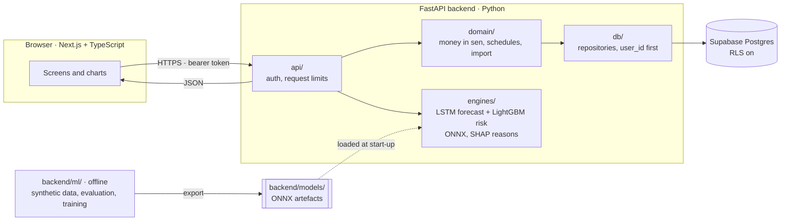

<div align="center">


# PaySense

**Think before you split.**<br>
A decision support system that tells Malaysian university students whether a buy-now-pay-later plan fits their money before they commit, using only their own records.

<p>
    
</p>

<sub>built with</sub>

<p>
  
  
  
  
  
  
  
</p>

<p>
  
  
  
  
</p>

<p>
  
  
  
  
  
  
  
</p>

<p>
  
  
  
  
</p>

<sub>Final Year Project, BSc (Hons) Computer Science, Universiti Teknologi PETRONAS · Nur Farah Binti Ahmad Nazri · Supervisor: Dr. Nazleeni Samiha Bt Haron</sub>

</div>

---

PaySense helps Malaysian university students decide whether a buy-now-pay-later (BNPL) plan fits *before* they commit. It forecasts the student's money from their own records, scores the risk of a proposed plan, and explains why.

This is the Final Year Project product, built after a first experiment (PaySense v1, published separately).

Repository: [github.com/farahjayy/PaySense-v2](https://github.com/farahjayy/PaySense-v2)

**Status:** the application is built and deployed (frontend on Vercel, API on Render, database on Supabase). Phase-by-phase detail, including what is still open, is in [`refdocs/STATUS.md`](refdocs/STATUS.md).

> PaySense gives estimates from a student's own records. It is **not financial advice and not a credit decision**.

## What it does

| | |
|---|---|
| **Financial health forecast** | Places the student's known income, bills and BNPL instalments on their exact dates, forecasts only the variable spending (and income, when it is irregular) with a global LSTM (chosen over ARIMA, Prophet and simple benchmarks), and simulates 1,000 possible futures: the projected monthly margin with a P10–P90 band and the probability that income alone cannot cover the plan. No account balance is needed. |
| **BNPL risk check** | Before a purchase, scores the probability that the student will not be able to pay an instalment in full: Safe / Caution / At Risk, from a calibrated LightGBM model (chosen over random forest, XGBoost and logistic regression) trained on simulated shortfall outcomes for a synthetic population of Malaysian students. |
| **Explanations** | The top reasons behind every score (SHAP) and the smallest change that would make the purchase Safe: fewer instalments, waiting until after the next allowance, a lower price, another provider. |
| **BNPL across providers** | SPayLater, TikTok PayLater, Atome and any other provider (entered manually) in one place, with provider-accurate schedules for the three named providers, the total monthly commitment, a due-date timeline and reminders. |
| **Ledger** | Manual entry, CSV / Excel import with preview, recurring income and bills, categories, a monthly income / expense / net summary. |
| **Sign-in and first visit** | Sign in with the username the author gave you. A first visit gets short welcome slides and a guided tour; both can be skipped and replayed. |
| **Privacy** | Every database query is scoped to the signed-in user; row-level security is on and there are no anonymous policies. |

## Architecture



The browser does no money arithmetic and uses types generated from the API's OpenAPI schema. Every figure on screen comes from a model, a simulation or the user's own data. Engine 2's features are defined in one place (`backend/app/engines/risk/features.py`), and the server refuses to start if a model's feature-schema hash does not match. The reasons for each choice are in [`refdocs/changelog/DECISIONS.md`](refdocs/changelog/DECISIONS.md).

## Measured results

All generated by scripts; nothing typed in by hand.

| What | Where |
|---|---|
| Engine 1 evaluation (forecasters against benchmarks, statistical tests) | [`reports/engine1/`](reports/engine1/) |
| Engine 2 training (model comparison, lockbox, calibration, ablation) | [`reports/engine2/`](reports/engine2/) |
| Synthetic population | [`reports/datagen/`](reports/datagen/) |
| Savings-buffer check | [`reports/buffer_check/`](reports/buffer_check/) |
| Serving checks (the served models against the offline ones) | [`reports/engine1/serving_check.md`](reports/engine1/serving_check.md), [`reports/engine2/serving_check.md`](reports/engine2/serving_check.md) |

## Honest limits

PaySense's risk score is trained on **synthetic** students, not on real repayment outcomes: 10,000 generated profiles (9,000 for development, 1,000 held back as a lockbox) whose label is the chance, simulated by the forecasting engine, that the student's running margin goes below zero once the plan is added. Many of those labels are already decided: 33.6% are exactly 0 and 20.9% exactly 1, and 58.4% are within 0.02 of 0 or 1. The label bands split 39.0% Safe, 10.4% Caution and 50.5% At Risk, so the model's accuracy (lockbox Brier 0.0198, against 0.1788 for always guessing the mean label and 0.0263 for logistic regression) is accuracy at copying the simulation, not at predicting real defaults. On the lockbox the model puts 91.5% of profiles in the same band as the label. Removing the six forecast features from the model raises the cross-validated Brier by 0.0996, so the forecast adds measurable skill within the simulation.

The LSTM beats the best benchmark (a 13-week moving average) on 13-week MASE: 0.8153 against 1.0438, over 242 series from the Berka and MoneyData accounts plus synthetic series. Its edge is clear on Berka (better on 72.5% of series in the per-series test) and weak on the synthetic series (7.5%). No real student results are in this repository, so nothing here shows how well the score predicts what actual students do.

Each figure above comes from a generated report: [`reports/engine1/README.md`](reports/engine1/README.md) and [`reports/engine2/README.md`](reports/engine2/README.md).

## Run it locally

Requirements: [uv](https://docs.astral.sh/uv/) (it installs the pinned Python 3.12), Node.js 20+ (developed on 24), and a Supabase project (free tier, Singapore region) for anything that touches the database. The full, current steps (both servers, the env files, seeding a user, troubleshooting) are in [`SETUP.md`](SETUP.md). In short:

```bash
git clone <this repo>
cd backend
cp .env.example .env      # fill in; see refdocs/guides/env_setup.md
uv sync
cd ../frontend
cp .env.example .env.local
npm install
```

Apply the SQL files in `backend/migrations/` to your Supabase project in order, then seed a user:

```bash
cd backend
uv run python scripts/seed_users.py --username demo --display "Demo" --persona budget_conscious
```

Then run the two servers:

```bash
# terminal 1
cd backend && uv run uvicorn app.main:app --reload --port 8000
# terminal 2
cd frontend && npm run dev   # http://localhost:3000 → sign in with the seeded username
```

## Tests

| What | Command |
|---|---|
| Backend lint and format | `cd backend && uv run ruff check . && uv run ruff format --check .` |
| Backend tests (an in-memory fake; `-m integration` hits the real Supabase) | `cd backend && uv run pytest` |
| Frontend | `cd frontend && npm run lint && npx tsc --noEmit && npm run test && npm run build` |
| API types match the backend | `cd frontend && npm run gen:api` after any backend route or schema change |
| Browser journeys, desktop and phone | `cd frontend && npx playwright test` |

## Deployment

The API runs on Render from `render.yaml` (Docker, deployed by hand), the frontend on Vercel. Steps, variables, the smoke test and the live checklist: [`refdocs/guides/deployment.md`](refdocs/guides/deployment.md).

## Data and privacy

This repository contains **no real personal financial data**. All personas and training data are synthetic, generated from published Malaysian statistics (sources in `refdocs/context/research-2026-10-08.md`). Real data, if any is ever collected, lives only in gitignored `data/private/`.

## Repository layout

```
PaySense_v2/
├── backend/
│   ├── app/                   the FastAPI service
│   │   ├── api/               route handlers: auth, transactions, imports, recurring, bills, plans, providers, categories, summary, forecast, risk, second opinion, alerts, model info, account
│   │   ├── core/              settings (fail-fast env), security (session tokens), errors (envelope), request body limit
│   │   ├── db/                Supabase client; ScopedTable (the user-isolation boundary) and the per-table repositories
│   │   ├── domain/            ledger, schedule (sen maths), providers, categorisation, recurring bills, plan building, CSV import, export
│   │   ├── engines/
│   │   │   ├── forecasting/   financial health forecasting (component model + Monte Carlo, served through ONNX)
│   │   │   └── risk/          BNPL risk classification (features.py, model, SHAP reasons, counterfactuals, repayment flag)
│   │   ├── export_openapi.py  writes the OpenAPI document with no credentials (used by `npm run gen:api`)
│   │   └── seed.py            tester account seeding
│   ├── ml/                    offline only: datagen/ (synthetic population), engine1_eval/, engine2_train/, uat/ (study pack and analysis), buffer_check.py
│   ├── models/                served artefacts and metadata (engine1/, engine2/)
│   ├── migrations/            0001 to 0004 SQL files + how to apply them
│   ├── scripts/               seed_users.py, seed_testers.py, set_role.py, check_rls.py, smoke_live.py
│   └── tests/                 unit tests on an in-memory fake; integration/ hits real Supabase; e2e_server.py backs Playwright
├── frontend/                  Next.js app: app/ (welcome, login, signed-in shell), components/, lib/ (session, api client + generated schema.d.ts), tests/unit + tests/e2e
├── data/                      personas/ (committed synthetic CSVs), external/ (download scripts); engine1/, engine2/ and synthetic/ hold generated files (large ones git-ignored, manifests committed)
├── reports/                   evaluation tables and figures (engine1, engine2, datagen), buffer_check, spikes, uat
├── uat/                       self-guided usability study kit: forms, instruments, purchase cards, tester template
├── public/                    logo for this README
└── refdocs/                   PRD, status, decisions, plans, execution plans, guides, context
```

## Documentation

| Doc | What's in it |
|---|---|
| [`refdocs/STATUS.md`](refdocs/STATUS.md) | Where the build actually is right now |
| [`refdocs/paysense-v2-PRD.md`](refdocs/paysense-v2-PRD.md) | Scope, architecture, both engine designs, roadmap, decision log |
| [`refdocs/changelog/CHANGELOG.md`](refdocs/changelog/CHANGELOG.md) | Session-by-session history |
| [`refdocs/changelog/DECISIONS.md`](refdocs/changelog/DECISIONS.md) | Why things are the way they are |
| [`refdocs/guides/env_setup.md`](refdocs/guides/env_setup.md) | Every environment variable and where to get it |
| [`refdocs/guides/deployment.md`](refdocs/guides/deployment.md) | Deploying to Render, Vercel and Supabase, and the live checklist |
| [`refdocs/guides/checklist.md`](refdocs/guides/checklist.md) | Pre-ship checklist |
| [`refdocs/context/`](refdocs/context/) | v1 lessons, research brief, academic constraints, BNPL billing rules |
| [`CLAUDE.md`](CLAUDE.md) | Operating brief for AI sessions on this repo |
